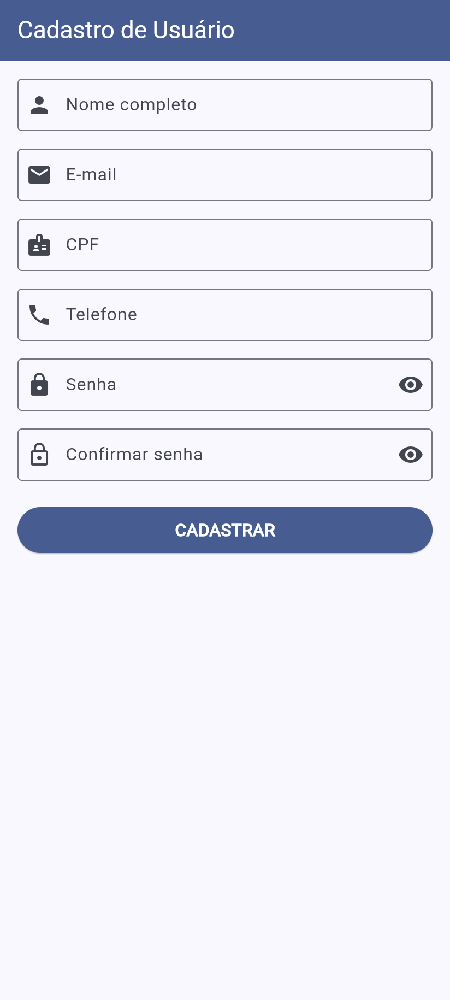
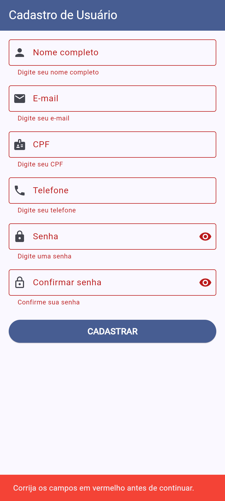
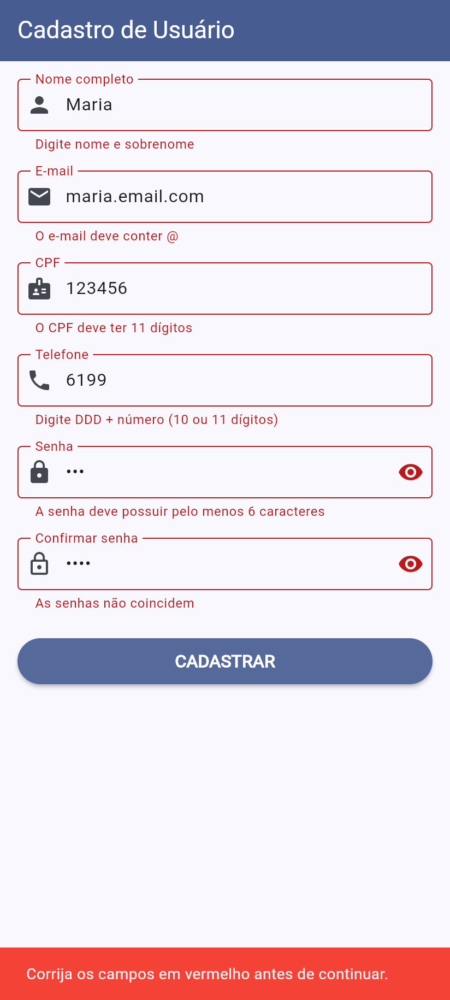
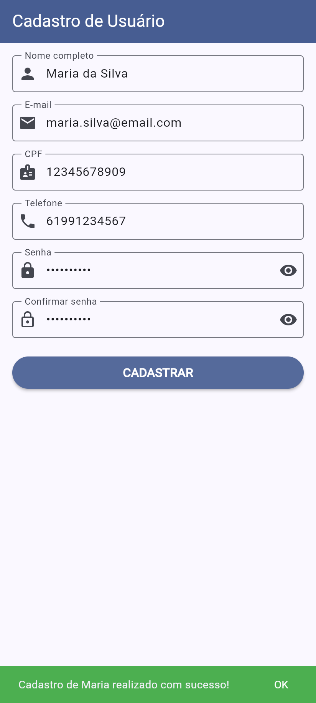
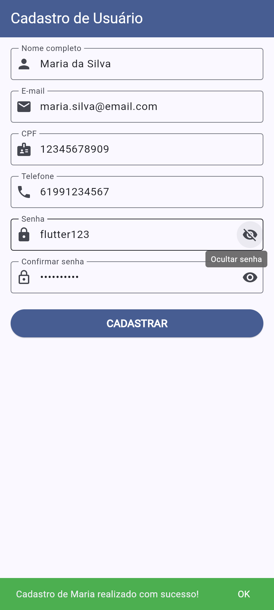

# Formulário de Cadastro de Usuário em Flutter

Atividade prática da disciplina **Desenvolvimento Mobile (Flutter e Dart)**, tema **Formulários e Validações no Flutter**.

Tela de cadastro com `TextFormField` dentro de um `Form`, filtros de entrada (`inputFormatters`), validação campo a campo e feedback com `SnackBar`.

## Prints do aplicativo rodando

| Tela inicial | Campos obrigatórios | Valores inválidos |
| :---: | :---: | :---: |
|  |  |  |
| Formulário vazio | Clique em **CADASTRAR** sem preencher: erro abaixo de cada campo e SnackBar vermelho | Cada campo mostra a regra que falhou |

| Cadastro com sucesso | Mostrar / ocultar senha |
| :---: | :---: |
|  |  |
| Todos os campos válidos: SnackBar verde de sucesso | Botão do olho exibe a senha digitada |

## Campos e regras de validação

| Campo | Teclado (`keyboardType`) | Filtro (`inputFormatters`) | Validação |
| --- | --- | --- | --- |
| Nome completo | `name` | bloqueia números | obrigatório, nome e sobrenome |
| E-mail | `emailAddress` | bloqueia espaços | obrigatório, deve conter `@`, formato validado com `RegExp` |
| CPF | `number` | `digitsOnly` + máximo 11 | obrigatório, exatamente 11 dígitos |
| Telefone | `phone` | `digitsOnly` + máximo 11 | obrigatório, DDD + número (10 ou 11 dígitos) |
| Senha | texto oculto | — | obrigatória, mínimo de 6 caracteres |
| Confirmar senha | texto oculto | — | obrigatória, igual à senha |

## O que foi implementado

**Atividade**

- [x] Tela com nome, e-mail, CPF, telefone e senha usando `TextFormField` dentro de um `Form`
- [x] `keyboardType` e `inputFormatters` adequados para cada campo
- [x] `validator` com regras específicas em cada campo
- [x] Mensagens de erro abaixo de cada campo inválido
- [x] `SnackBar` de sucesso após o cadastro

**Desafio**

- [x] Campo de confirmação de senha, validando se os dois valores são iguais
- [x] Botão para mostrar/ocultar a senha
- [x] Validação de e-mail mais robusta com `RegExp`
- [x] `SnackBar` de erro (vermelho) ao tentar cadastrar com campos inválidos

**Extra:** depois da primeira tentativa com erro, o formulário passa a validar em tempo real (`AutovalidateMode.onUserInteraction`) e a mensagem some assim que o campo é corrigido.

## Estrutura da tela

```
Scaffold
└── Form(key: _formKey)
    └── SingleChildScrollView (padding: 16)
        └── Column
            ├── TextFormField (nome)
            ├── TextFormField (e-mail)
            ├── TextFormField (CPF)
            ├── TextFormField (telefone)
            ├── TextFormField (senha)
            ├── TextFormField (confirmar senha)
            └── ElevatedButton (CADASTRAR)
```

Entre os campos há `SizedBox(height: 16)`. O código está em [`lib/main.dart`](lib/main.dart).

## Como executar

Pré-requisito: Flutter SDK instalado (`flutter doctor`).

```bash
git clone https://github.com/ThiagoPatrickR/atividade-forms.git
cd atividade-forms
flutter pub get
flutter run -d chrome   # ou: flutter run (emulador / celular)
```

## Testes

Os testes de widget em [`test/widget_test.dart`](test/widget_test.dart) cobrem campos vazios, filtros de CPF e telefone, mensagens de cada regra, e-mail inválido, cadastro com sucesso e o botão de mostrar senha.

```bash
flutter test
```

---

Feito com Flutter 3.47 e Dart 3.13.
